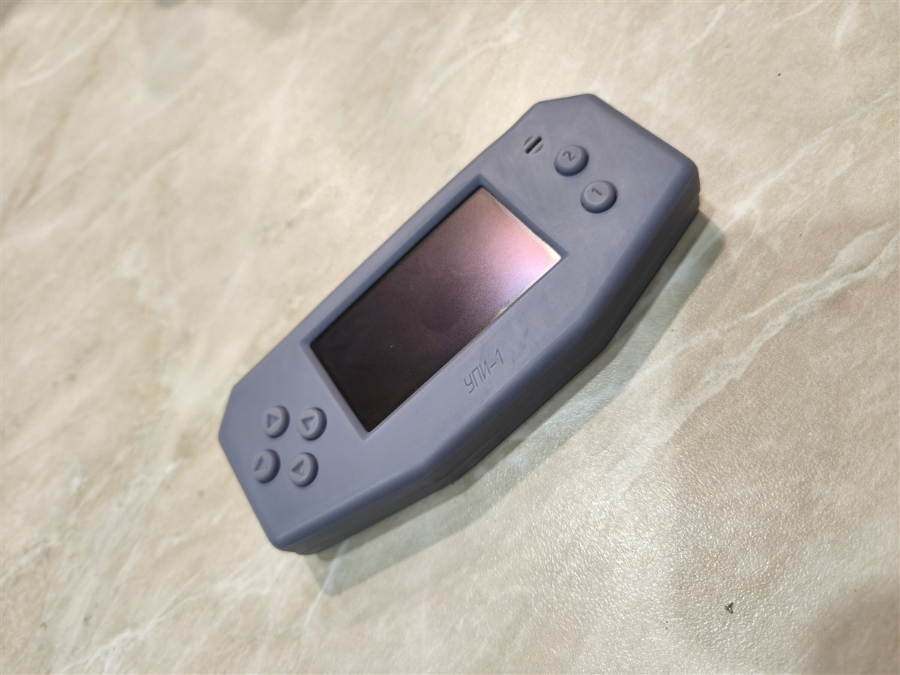
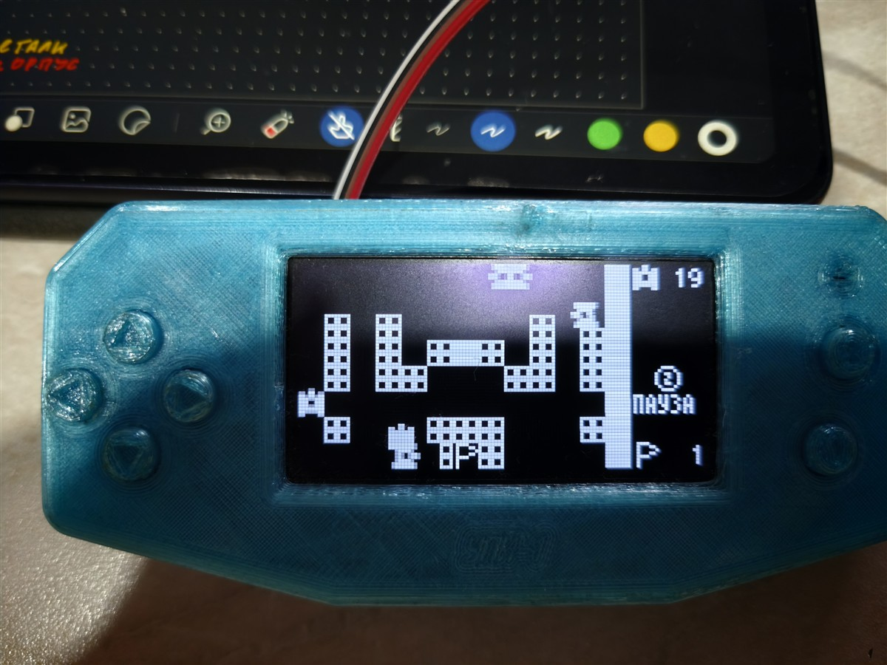
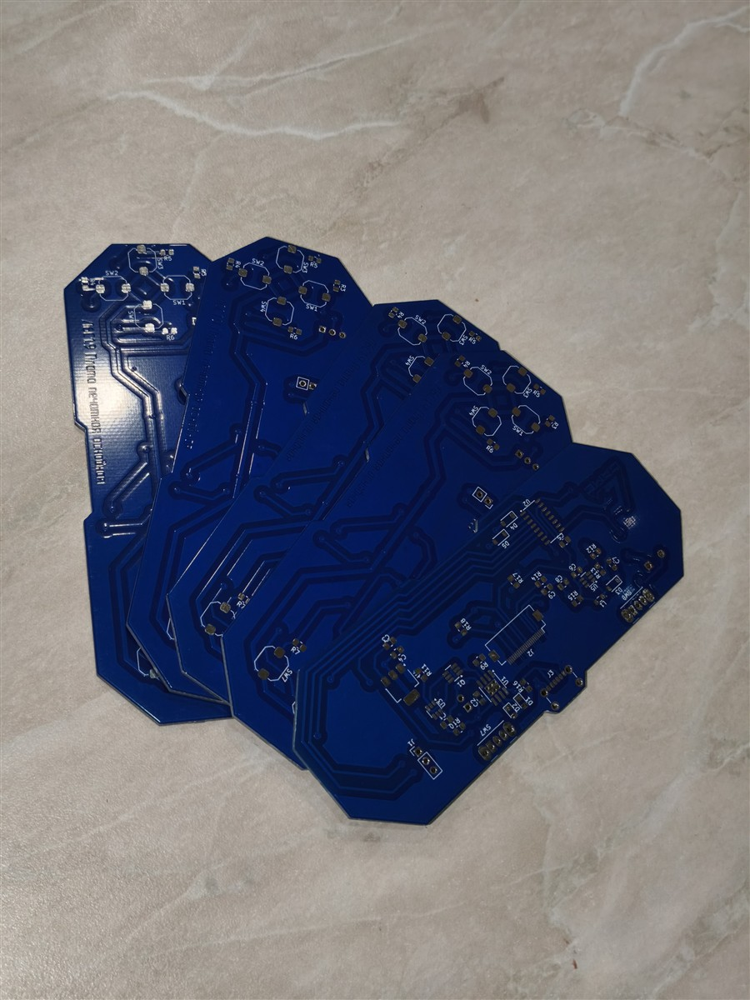

# УПИ-1 — самодельная портативная игровая консоль

*УПИ — **У**стройство **П**ортативное **И**гровое; 1 — первое в серии.*

Прошивки, утилиты разработки, проект платы и 3D-модели корпуса самодельной
ретро-консоли на микроконтроллере **WCH CH32V003** (RISC-V, 48 kB FLASH, 2 kB RAM).

> **Основано на:** [CH32V003-GameConsole](https://github.com/wagiminator/CH32V003-GameConsole) —
> открытой мини-консоли Стефана Вагнера ([wagiminator](https://github.com/wagiminator)).
> Архитектура, базовые драйверы CH32V003 и порты классических игр унаследованы оттуда;
> аппаратная часть и значительная часть прошивок переработаны для УПИ-1.



[English summary](#english-summary)

## Характеристики консоли

| Параметр      | Значение                                             |
|---------------|------------------------------------------------------|
| МК            | CH32V003A4M6 (TSSOP20) @ 12 МГц (HSI)              |
| Экран         | OLED 128×64, SSD1306, I2C (bit-bang, SDA=PC1, SCL=PC2)|
| Звук          | активный звукоизлучатель на PC0                      |
| Управление    | D-pad: UP=PC3, LEFT=PC4, DOWN=PC6, RIGHT=PC7; ACT1=PD4, ACT2=PD5 |
| Питание       | батарейное (см. раздел «Аппаратная часть»)           |

## Структура репозитория

```
firmware/     — прошивки (каждый проект = отдельный PlatformIO-проект)
tools/        — браузерные утилиты разработки и палитры для редактора карт
hardware/     — проект основной платы (KiCad)
enclosure/    — 3D-модели корпуса (конфигурации k1–k3)
```

## Прошивки (`firmware/`)

| Проект                  | Описание | Происхождение |
|-------------------------|----------|---------------|
| `template`              | Шаблон для новых игр: кнопки, звук, отрисовка | свой код на базе шаблонов wagiminator |
| `tiny-tris`             | «Тетрис» | Tiny Tris (Daniel C), CH32V003-порт wagiminator, адаптирован |
| `tiny-invaders`         | «Космические захватчики» | Tiny Invaders (Daniel C), CH32V003-порт wagiminator, адаптирован |
| `tiny-arkanoid`         | «Арканоид» | Tiny Arkanoid (Daniel C), CH32V003-порт wagiminator, адаптирован |
| `snake`                 | «Змейка» | порт игры Terrabyte (Dmitriy Stukalov) |
| `maze`                  | Лабиринт, 20 уровней зашиты в ресурсы | своя игра |
| `sever-race-mini`       | Гонки с сохранением рекорда во FLASH | своя игра |
| `tanks`                 | Танковые бои по карте 24×16 | своя игра |
| `dupi`                  | Raycaster-шутер от первого лица (fixed-point) | своя игра |

Общая часть своих игр — `engine.h` (API консоли `UPI_*`) и `draw.c/h`
(фреймбуфер 128×64 поверх SSD1306-драйвера `oled.c`).



## Сборка и прошивка

Каждая папка в `firmware/` — самостоятельный [PlatformIO](https://platformio.org)-проект.

1. Установьте PlatformIO Core или расширение PlatformIO IDE для VS Code.
2. Платформа `CH32V` подтянется автоматически (используется
   [community platform-ch32v](https://github.com/Community-PIO-CH32V/platform-ch32v),
   плата `genericCH32V003A4M6`).
3. Сборка: откройте папку проекта и выполните `pio run`.
4. Прошивка: `pio run -t upload` — через WCH-Link (`upload_protocol = wch-link`)
   либо другим способом по UART, настроив `upload_port`/`upload_protocol`.

Часть проектов дополнительно содержит `makefile` для сборки без PlatformIO.

Предупреждение: прошивка CH32V003 «съедает» сброс в режим WCH-Link по умолчанию —
для перепрошивки может потребоваться утилита WCHISPTool или режим Force.

## Утилиты (`tools/`)

Открываются в любом браузере, интернет не нужен:

- **img4upi.html** — конвертер картинок в монохромные битмапы для прошивок;
- **map4XxX.html** — редактор тайловых карт (палитры из `tools/palettes/`:
  `25x25.json`, `tanks.json`, `dupi.json`);
- **music4upi.html** — редактор частотных последовательностей для звукоизлучателя.

## Аппаратная часть

Проект основной платы — в `hardware/` (KiCad): схема, трассировка,
инструкции по экспорту производственных файлов. 3D-модели корпуса — в `enclosure/`:
три конфигурации (k1 — девелоперская с разъёмом программирования, k2 — стандартная,
k3 — special edition без логотипа), подробнее в `enclosure/README.md`.



## Третьи авторы

- **Стефан Вагнер ([wagiminator](https://github.com/wagiminator))** — источник всего
  фундамента проекта: его [CH32V003-GameConsole](https://github.com/wagiminator/CH32V003-GameConsole)
  дал УПИ-1 архитектуру, базовые драйверы (`system.h`, `gpio.h`, `i2c_tx.*`,
  `ch32v003.h`, `driver.h`, `oled_term.*`, `millis.*`, `flash.*`, CC BY-SA 3.0) и
  CH32V003-конверсии классических игр.
- **Daniel C ([TinyGamePad](https://www.tinyjoypad.com))** — оригиналы Tiny Tris /
  Tiny Invaders / Tiny Arkanoid (GPLv3).
- **Dmitriy Stukalov (Terrabyte)** — порт «Змейки» на шаблонах wagiminator.

## Контакты

Telegram: [@likus_workshop](https://t.me/likus_workshop) · VK: [vk.ru/likusworkshop](https://vk.ru/likusworkshop)

## Лицензия

Репозиторий публикуется под **GNU GPL v3** (или новее) — см. [LICENSE](LICENSE).
Файлы сторонних авторов сохраняют свои исходные лицензии и указанны в шапках;
детали — в разделе «Третьи авторы».

---

## English summary

**UPI-1** (from Russian «Устройство Портативное Игровое» — *portable gaming
device*, unit 1) is a personal DIY handheld game console project. **It is based
on [CH32V003-GameConsole](https://github.com/wagiminator/CH32V003-GameConsole)
by Stefan Wagner ([wagiminator](https://github.com/wagiminator))** — the console
architecture, the base CH32V003 drivers and the classic-game conversions are
inherited from it, while the hardware and much of the firmware were reworked.
The console is built around the WCH CH32V003 RISC-V MCU with a 128×64 SSD1306
OLED display, an active buzzer and six GPIO buttons. This repository holds the
firmware (PlatformIO projects: classic game ports and original games — a maze,
a racing game with FLASH high-score storage, tanks and a fixed-point
raycaster), browser-based development tools (image/map/sound converters), the
KiCad board project and printable enclosure models (three configurations). See
the Russian text above for details. Licensed under GPLv3; third-party files
keep their original licenses (CC BY-SA 3.0 by wagiminator, GPLv3 TinyGamePad
games by Daniel C).
